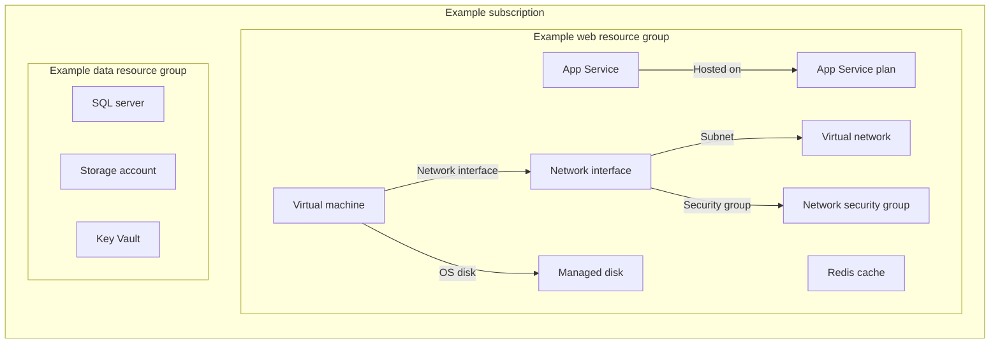

# Example Azure subscription architecture

This is a fictional example, not an inventory of a deployed environment.
Subscription identifiers, names and resources are illustrative. Azure Vision's
`SOURCE=mock` mode uses synthetic Production and Development subscriptions so
you can explore the UI without connecting to Azure.

## Example inventory

| Subscription | Resource group | Example resources |
|---|---|---|
| Production | `rg-web-prod` | Virtual network, network security group, virtual machines, App Service and Redis |
| Production | `rg-data-prod` | Virtual network, virtual machines, SQL server, storage account and Key Vault |
| Development | `rg-web-dev` | Development equivalents of the web resources |
| Development | `rg-data-dev` | Development equivalents of the data resources |

The mock subscription IDs are repeated-digit UUIDs used only as test data.
Mock costs are deterministic examples, not actual spend.

## Illustrative relationships

Only explicit example relationships are drawn. Co-location in a resource group
does not prove that an application uses a database, cache, storage account or
vault. Azure Vision derives edges from supported resource properties; it does
not infer every runtime dependency.

## Generate your own view

Run the application with `SOURCE=mock` to inspect synthetic resources, or sign
in to Azure with your own account to query resources permitted by your RBAC.
Drill into subscriptions and resource groups, apply type filters, and enable
the cost overlay to correlate resource IDs with attributed spend.

Keep real inventory exports, diagrams, screenshots and scan reports private.
Before publishing examples, replace organization names, account identifiers,
resource names, URLs and costs with synthetic data.
